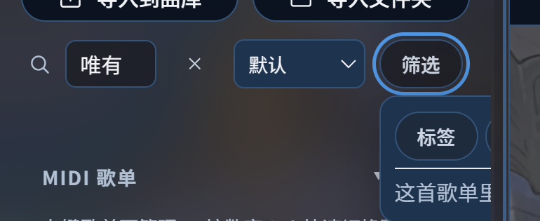
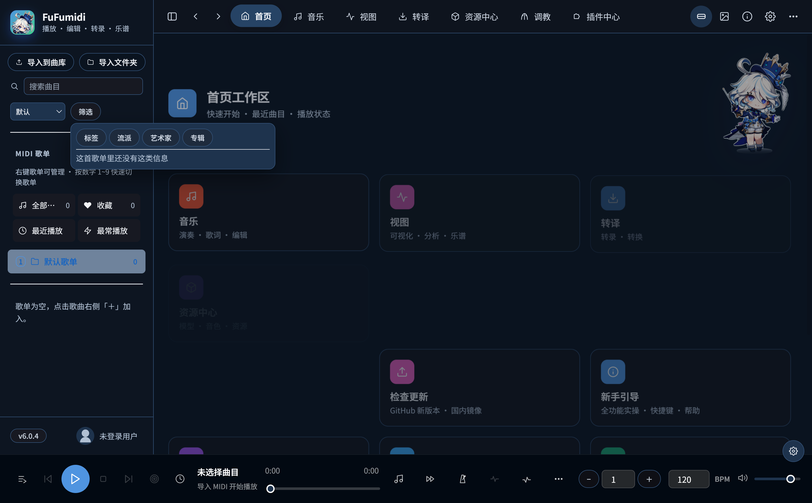

# 侧栏「搜索 + 筛选」布局重叠 / 浮层被裁切（2026-10-18）

## 现象

- 搜索框与「整理方式」「筛选」挤在同一行，侧栏较窄时输入框被压缩（placeholder 只剩「搜索曲」）。
- 点击「筛选」后，浮层只露出左上角（「标签」+「这首歌单里…」），其余被侧栏裁切，无法选择流派/艺术家/专辑。

## 复现

1. 打开应用（默认侧栏，任意曲库）；
2. 点击侧栏「筛选」；
3. 浮层在侧栏右缘被裁切（见 before）。

## 根因

1. `.pl-search` 为单行 flex：搜索框 + 排序 select + 筛选按钮 + 清除按钮共享一行，窄侧栏下输入框被压到不可用宽度；
2. `.lib-filter-pop` 原本 `position: absolute`（相对 `.lib-filter`），侧栏滚动/溢出容器会裁切超出部分；
3. 浮层 `left: 0` 锚在靠近侧栏右缘的按钮上，`width: min(280px, 78vw)` 必然越界并被裁切。

## 修复方案（已在 v6 分支实现，commit `a1cc86c`）

- 搜索框独占第一行（`.pl-search`）；第二行 `.pl-controls` 放「整理方式 + 筛选」，两者不再互相挤占；
- 筛选浮层改为 `<Teleport to="body">` + `position: fixed`，打开时按按钮 rect 计算位置：
  - 水平夹紧视口（右缘不足时左移，最小 8px 边距）；
  - 下方空间不足 240px 时翻到按钮上方；
  - `resize` / `scroll` 时重新定位；点击外部或 Esc 关闭；
- 原有标签/流派/艺术家/专辑四类与计数、清除筛选逻辑不变。
- 新增 E2E `scripts/e2e/cases/sidebar-filter-ui.mjs`：断言搜索独占一行、整理+筛选同排、浮层完全在视口内、四类筛选存在、Esc 关闭。

## 验证

- `npm run test:e2e -- sidebar-filter-ui` 通过；
- `typecheck` / `audit`（i18n、token）通过；
- `build:ui` + `deploy-installed` 安装版冒烟通过（首屏正常、0 未捕获异常）。

## 给协助者

- 本 PR 由 GitHub API 生成：本机到 `github.com:443` 的 git 通道超时，无法直接推分支；Release 资产上传通道可用。
- 建议把 `patches/sidebar-search-filter.patch` 应用到 **v6.0.0 源码分支**（CNB `FuFuCloud-mirror/FuFuMIDI`，commit `a1cc86c`），而不是直接合并到 `master`（`master` 仍是 5.2.4 基线）。
- 请在真实窄侧栏 / 高 DPI 环境复查；如果侧栏宽度记忆值很小，浮层会自动夹紧但可能覆盖主区域，可考虑改为右侧 Sheet 呈现。
